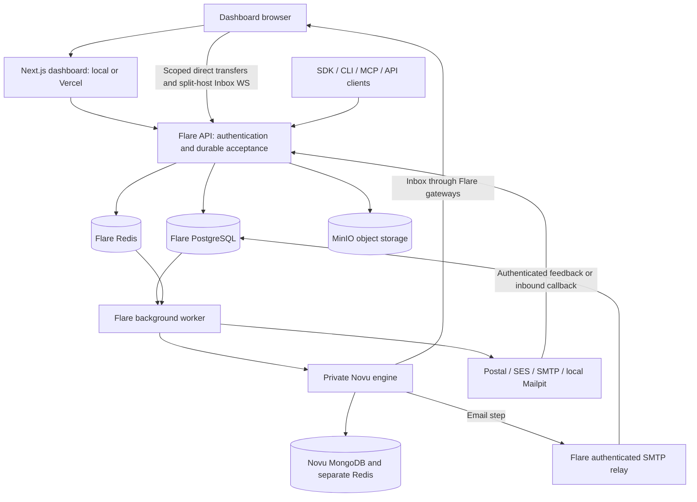

# Flare: website navigation and backend guide

Updated: **19 October 2026**. Based on implementation checkpoint **`db4f0a4`**.

Flare is Pareto Labs' notification control plane. The dashboard manages notifications, outgoing and incoming email, audiences, reusable content and operations. Behind it, Flare owns access control, durable records and sending policy; the unmodified Novu engine executes notification workflows, and Postal is the default real email transport.

The main feature modules and the Vercel split-host foundation are built. Local Docker acceptance and [all five CI jobs for this checkpoint](https://github.com/ChariPramod/flare/actions/runs/39343365896) passed. **A public Vercel/backend deployment and real Postal deliverability have not been verified.** This guide describes the implemented product, not a live hosted service.

## Reading paths

- **I want to use the website:** start with [opening Flare](#opening-flare), the [sidebar map](#sidebar-map) and [guided journeys](#guided-journeys).
- **I want to understand what is built:** read [feature status](#what-is-built-and-what-is-verified) and [the backend](#what-runs-on-the-backend).
- **I want to change or test it:** use [the source map](#where-to-change-things) and [tests, pytest, lint and evals](#where-to-write-tests-pytest-lint-and-evals).
- **I want to deploy it:** read [what remains](#what-remains-before-the-first-pilot) and the linked operating instructions.

## Opening Flare

For a running default local stack, open **[http://localhost:3000/login](http://localhost:3000/login)**. The root URL redirects to Overview. Use the exact origin configured for your stack: `localhost` and `127.0.0.1` are different browser origins, particularly for cookies and Inbox access.

Sign in with the seeded or invited account. Local seed credentials come from your private `.env` (`SEED_OWNER_EMAIL` and `SEED_OWNER_PASSWORD`); this guide does not contain passwords. If MFA is enabled, enter an authenticator or recovery code. SSO appears only when configured. Invitations use `/invite?token=…`; there is no general self-signup or password-reset screen in the current UI.

If the stack is not running, follow the [root development instructions](../../README.md#development). They cover Node 22, pnpm, Docker, generated local secrets, startup and seeding. The full stack needs at least 12 GB of allocated RAM. Novu service credentials and external providers require their own configuration; starting containers does not configure real delivery automatically.

Other default local tools are:

| Tool                    | Address                      | Purpose                                                   |
| ----------------------- | ---------------------------- | --------------------------------------------------------- |
| Flare API documentation | `http://localhost:4000/docs` | Browse the public API contract.                           |
| Mailpit                 | `http://localhost:8025`      | Inspect email captured by the isolated local transport.   |
| MinIO console           | `http://localhost:9001`      | Administrative inspection of private object storage.      |
| Postal administration   | `http://localhost:5000`      | Configure Postal servers, credentials and sender domains. |

These are local administrative tools, not extra dashboard pages. Published Compose ports bind loopback; deployment access follows the staging configuration. A prior test run passing does not mean its disposable containers are still running.

### Getting oriented

1. Select your **organization** and **Development/Production environment** in the navigation area. Switching changes the data context, clears cached queries and returns a detail view to its section's list.
2. Open **Overview** for sending approval, recipient allowance, sender readiness and recent held/failed emails.
3. Use the sidebar to enter a feature. **Cmd/Ctrl+K searches page names**, not every record in the database.
4. Use the account menu for **Settings** or sign-out. The sidebar can collapse; small screens use an **Open navigation** drawer. The theme control switches light/dark appearance.

Owner/admin/developer roles are generally writable; viewers have read-only controls. Team management and dashboard publication require owner/admin. The API checks permissions independently of what the UI displays.

Production blocks direct editing of workflow definitions, templates, layouts, translations and automation definitions. It still permits authorized operational work such as sends and subscriber/contact management. Publication does not copy environment credentials, subscribers, contacts, integrations or topics.

## Sidebar map

Routes below are appended to the dashboard origin. Detail pages open by selecting a row or item.

### Workspace

| Page          | Route           | What you do there                                                                                 |
| ------------- | --------------- | ------------------------------------------------------------------------------------------------- |
| Overview      | `/overview`     | See the selected context, sending policy, quota, readiness and items needing attention.           |
| Workflows     | `/workflows`    | Create notification workflows, configure ordered channel/action steps, save and trigger tests.    |
| Subscribers   | `/subscribers`  | Manage notification recipients, their profile, channel/workflow preferences and **In-app Inbox**. |
| Topics        | `/topics`       | Group subscribers and manage subscriptions with their exact context.                              |
| Activity feed | `/activity`     | Inspect workflow runs, Flare dispatch state and observed native Novu jobs.                        |
| Integrations  | `/integrations` | Configure supported notification-channel providers for the selected environment.                  |
| Layouts       | `/layouts`      | Version reusable HTML wrappers containing exactly one `{{{body}}}` insertion marker.              |
| Translations  | `/translations` | Edit/import/export workflow locale dictionaries and use default-locale fallback.                  |

### Email

| Page           | Route           | What you do there                                                                                               |
| -------------- | --------------- | --------------------------------------------------------------------------------------------------------------- |
| Emails         | `/emails`       | Compose or schedule mail; inspect recipients, attempts, events, content and eligible cancellation/rescheduling. |
| Domains        | `/domains`      | Add sender/receiving domains, obtain DNS records and inspect ownership, tracking and sending readiness.         |
| Audience       | `/audience`     | Manage marketing contacts, typed properties, segments and audience topics; import CSV and manage preferences.   |
| Broadcasts     | `/broadcasts`   | Send a pinned template to a selected audience, schedule it and inspect progress.                                |
| Automations    | `/automations`  | Build durable contact sequences with email, waits, events and conditions; inspect runs.                         |
| Templates      | `/templates`    | Create versioned subject/HTML/text content and preview sample variables.                                        |
| Received email | `/inbound`      | Read mail received by a domain, inspect source/attachments and manage forwarding rules.                         |
| Suppressions   | `/suppressions` | Inspect organization-wide restrictions and manage permitted manual suppressions.                                |
| Webhooks       | `/webhooks`     | Configure event destinations and inspect signed deliveries, attempts and eligible replay.                       |
| Logs           | `/logs`         | Search redacted request logs and open request/response details.                                                 |
| Metrics        | `/metrics`      | Filter delivery/engagement aggregates by time and supported dimensions.                                         |
| Dead letters   | `/dead-letters` | Inspect failed work and redrive eligible operations after addressing the cause.                                 |

### Developer

| Page         | Route           | What you do there                                                                                                     |
| ------------ | --------------- | --------------------------------------------------------------------------------------------------------------------- |
| API keys     | `/api-keys`     | Create/revoke keys with fixed permissions, environment and optional domain scope. Copy a new secret when first shown. |
| Environments | `/environments` | Choose an environment card and configure its Novu API key, webhook signing secret, application ID and Bridge URL.     |
| Bridge       | `/bridge`       | Open the same environment configuration editor with Bridge-oriented guidance. This is not a code editor.              |
| Team         | `/team`         | Owners/admins invite teammates and manage membership roles.                                                           |
| Settings     | `/settings`     | View profile information, set up/manage MFA and inspect recent audit activity.                                        |

The **platform operator dashboard** is separate at `/operator`, outside the tenant sidebar. It controls approval/suspension, allowances, route assignments, readiness evidence and protected suppression restoration. It requires a deployment-allowlisted operator, a live session and recent MFA step-up valid for 15 minutes. Being a tenant owner/admin does not grant operator access.

Public recipient preference links use `/preferences/<token>`. They are generated from a contact and should be treated as private recipient links.

## Guided journeys

### 1. Build a notification and inspect its Inbox

1. Select **Development**. In **Environments** and **Integrations**, configure the required Novu environment and channel credentials.
2. Go to **Subscribers → Add subscriber**. Use a stable identifier from your product, such as a test user ID.
3. Go to **Workflows → Create workflow**. The editor supports **In-app, Email, SMS, Push, Chat, Delay, Digest, Throttle and HTTP request** steps. Use its explicit add/reorder controls; the canvas is not a freely connected drawing surface.
4. Select a step and use **Configure / Content / Conditions**. Workflow Settings includes metadata, enabled/critical/default preferences and payload JSON Schema.
5. **Save changes**, then **Test workflow**. Enter the subscriber identifier and JSON payload, and choose **Run test**. This triggers real work using saved content.
6. Open the resulting **Activity feed** run. Flare dispatch state and native engine progress are shown separately.
7. Open the subscriber detail page and its **In-app Inbox**. Writable users interact with the native Novu Inbox and can change read state; viewers receive a read-only feed. Use **Reconnect Inbox** to refresh access when needed.

**In-app Inbox is not Received email.** Inbox contains notifications for a product subscriber. Received email contains messages delivered to one of your receiving domains.

### 2. Send email and understand its result

1. Go to **Domains → Add domain**, open the domain and copy its required DNS records. Inspect ownership verification and **Sending readiness** separately.
2. For real sending, obtain operator approval, an approved route/classification and current provider readiness evidence. Domain verification alone cannot unlock sending. For local testing, use the configured isolated Mailpit transport.
3. Go to **Emails → Send email**. Enter From, To/Cc/Bcc, subject and HTML or text. Add optional scheduling, attachments and an allowed traffic classification.
4. Open the resulting email detail. Review recipient states, attempts and the event timeline. **Preview / Request / Plain text / Raw MIME** help inspect what was accepted and constructed.
5. Use cancellation or rescheduling only when offered for the message's state. Once a provider has accepted work, cancellation cannot recall it.

The initial real-send allowance is **100 logical recipients per rolling 24 hours and 10 recipient attempts per rolling 60 seconds**. It is shared across keys and submission channels; real outbound Development traffic also counts. Retries/failover consume attempt capacity without consuming a second logical daily unit. Scheduled work reserves capacity when due. Policy holds remain durable and visible.

An authenticated complaint, or at least a 5% hard-bounce rate across at least 20 recipients in the rolling window, automatically pauses sending for operator review. These are pilot safeguards, not universal mailbox-provider standards. Tenant users can remove manual suppressions; protected provider restrictions require audited operator restoration. See [sender policy and readiness](sender-reputation.md).

### 3. Read incoming mail or configure forwarding

1. Configure the verified receiving domain and Postal callback as described in [inbound setup](inbound.md).
2. Open **Received email**, then a message. Inspect **Plain text / HTML preview / Headers / Parsing attempts**, download the original MIME or retrieve attachments.
3. Review forwarding history and use **View outgoing email** to follow a forwarded copy through the ordinary mail pipeline.
4. On the list page, use **Forwarding rules** for an exact recipient or catch-all rule, a verified forwarding sender and destinations.

Envelope recipients are preserved separately from visible headers. HTML previews are sanitized and sandboxed without automatic remote-image loading, so they may look different from a recipient's mail client. Incoming MIME is excluded from request logs.

### 4. Reuse content and publish it

1. In **Templates**, create subject/HTML/text content, preview variables and save immutable versions.
2. In **Layouts**, create wrapper HTML with one `{{{body}}}` marker and save a version. Layouts are wrappers, not arbitrary payload templates.
3. In **Translations**, select a workflow and edit/import/export locale JSON. `en_US` supplies the default values; missing locale keys fall back individually.
4. In workflow email content, choose the layout/version and preview a locale. Resolved content is stored with accepted runs so retries reproduce it.
5. As a Development owner/admin, choose **Publish changes**. Select **Workflows / Layouts / Translations / Automations**, inspect the diff and required dependencies, then publish and follow operation/item progress.

Templates travel as required pinned dependencies; there is no separate Templates category in this publication dialog. Publication is durable and resumable; published workflow items are reconciled with Novu before completion. Automation, layout and translation items complete locally. Configure Production subscribers, contacts, providers and credentials separately.

### 5. Use audiences, broadcasts and automations

**Audience contacts are distinct from workflow subscribers.** Audience has Contacts, Properties, Segments and Topics tabs; its topics are also distinct from sidebar Topics. Add contacts or import CSV with preview/header mapping, define typed properties and use JSON rules for segments. Contact detail exposes opt-out/topic preferences and a recipient preference link.

For a broadcast, create a versioned template, then choose **Broadcasts → Create broadcast**. Set sender, template, audience and throttling, review scheduling, and monitor the audience/email outcomes. Broadcasts are marketing traffic and require approval for that route; the requested rate does not override organization limits.

For an automation, choose **Automations → Create automation**, define its trigger and connect `send_email`, `wait`, `wait_for_event` and `condition` steps. Configure template pins, sender, delays or JSON Logic, then **Save sequence**. Existing runs retain their original definition. Run details show step history, contact, outgoing emails and eligible cancellation.

**Send test event is a real event:** every enabled matching automation can react, including sending mail. Use an isolated environment and test contacts. Some configuration uses JSON editors; not every feature is a visual wizard.

### 6. Investigate a problem

Start with **Overview** for held/failed mail, **Emails** for recipient/transport facts, or **Activity feed** for workflow execution. Use **Logs** for the corresponding redacted API request, **Webhooks** for delivery attempts, **Metrics** for aggregates, and **Dead letters** for eligible recovery.

| Status or observation                 | What it establishes                                                                                                      |
| ------------------------------------- | ------------------------------------------------------------------------------------------------------------------------ |
| Workflow accepted                     | Flare submitted the run to Novu; downstream channel delivery may still be pending.                                       |
| Email sent / provider accepted        | The transport accepted the message; this is not final delivery.                                                          |
| Email delivered                       | Receiving-server confirmation was recorded; this does not prove inbox placement.                                         |
| Held                                  | Delivery is durably blocked by policy/readiness/capacity. Inspect `hold_reason` and `next_attempt_at`.                   |
| Ambiguous acceptance                  | Flare cannot establish whether the provider accepted it. Automatic failover/redrive is withheld to avoid duplicate mail. |
| Broadcast sent                        | Audience submission completed; inspect individual emails for delivery results.                                           |
| Native progress unavailable/not found | Engine observation is incomplete; it does not establish that no native work exists.                                      |
| Bridge configured                     | A configuration value exists; it is not a health check.                                                                  |

Resolve the cause before redriving eligible definitive failures. Canceled, successful, active or ambiguous work cannot be treated as ordinary failed work. Postal feedback does not always establish a hard/soft bounce classification or authenticated complaint; unknown evidence stays unknown.

Search and pagination are bounded. Many tables paginate up to 100 loaded records in 25-row pages. Inbound retrieves pages of 50 and searches the current loaded page; forwarding rules paginate independently. Some resources have their own server pagination. Do not assume a search covered all historical records.

## What is built and what is verified

| Area                     | Implemented                                                                                                                                 | Evidence boundary                                                                                                                                         |
| ------------------------ | ------------------------------------------------------------------------------------------------------------------------------------------- | --------------------------------------------------------------------------------------------------------------------------------------------------------- |
| Identity and permissions | Password/MFA/recovery, invitations, roles, environment isolation, scoped keys, operator step-up, optional OIDC                              | Local browser and API coverage; a real external OIDC tenant is not configured.                                                                            |
| Notifications            | Workflow editor, subscriber/preferences/topics, native progress/cancellation, Inbox, publication                                            | Pinned Novu tested locally, including actions and recovery. Credentialed SMS/push/chat delivery remains external.                                         |
| Email                    | Durable acceptance, idempotency, scheduling, MIME/DKIM, attachments, routes, retries, suppression, policy/quota and authenticated callbacks | Mailpit, local SMTP/Postal and fault scenarios pass. Public DNS, actual sending IPs/pools, receiver authentication and inbox placement remain unverified. |
| Inbound and marketing    | MIME parsing, attachments, forwarding, audience, preferences, templates, broadcasts and durable automations                                 | Controlled local/database/browser scenarios pass; real inbound DNS and external feedback remain deployment work.                                          |
| Operations               | Signed webhooks, redacted logs, metrics, dead letters, correlation, recovery tooling, encrypted backup profiles and alerts                  | Local rehearsals pass; off-host custody/restore and real alert receipt still need staging evidence.                                                       |
| Vercel foundation        | Signed dashboard forwarding, direct large transfers, private Inbox HTTP/WebSocket gateways, split ingress and backup profiles               | Vercel-mode build and local boundary/reconnect tests pass. No actual Vercel/public backend deployment is claimed.                                         |
| Developer tools          | Generated OpenAPI, typed TypeScript SDK, CLI and local stdio MCP                                                                            | Installable-package checks pass; registry publication is outside the completed scope.                                                                     |

The checkpoint recorded **890 unit/database tests, 25 deterministic evals, 79 service integration tests, 48 browser contracts and 12 live browser flows**, plus **45 Python tests with four external skips**. Standard lint/type/build/OpenAPI/secret checks and local upgrade/load/recovery rehearsals passed. These are dated results, not a guarantee of future code or real-provider behavior. Use [PROGRESS](../../PROGRESS.md) and [the acceptance ledger](../development/acceptance.md) for subsequent checkpoints; older feature documents may contain historical test counts.

## What runs on the backend

| Component                             | Responsibility and data                                                                                                                                                         |
| ------------------------------------- | ------------------------------------------------------------------------------------------------------------------------------------------------------------------------------- |
| `apps/web`                            | Next.js/React dashboard, workflow canvas, JSON editors and Inbox UI. Its server routes forward ordinary requests to the API.                                                    |
| `apps/api`                            | NestJS control plane: authentication, tenancy, resources, acceptance, callbacks, operator controls and browser gateways.                                                        |
| `apps/worker`                         | Delivery, workflow submission, inbound parsing, broadcasts, automations, publication and webhook jobs; periodic dispatch/recovery, DNS/readiness and cleanup.                   |
| `apps/smtp-relay`                     | STARTTLS and API-key-authenticated submission on port 2525 into Flare's shared mail pipeline. This is separate from Postal's SMTP server.                                       |
| PostgreSQL                            | Authoritative Flare accounts, tenants, sessions, definitions, message/recipient/attempt records, durable operations, outbox, audit and upload journal.                          |
| Flare Redis                           | BullMQ execution, rate limits and transient coordination/replay/Inbox bindings. Eligible Flare queue work can be recovered from durable PostgreSQL state.                       |
| MinIO                                 | Private outgoing attachments/signed MIME and incoming raw MIME, bodies and attachments; separate Flare and Novu buckets.                                                        |
| Novu community 3.19.0                 | Unmodified notification execution, channel providers, actions and Inbox. It has its own MongoDB and Redis; its stock dashboard remains private.                                 |
| Postal 3.3.7                          | Default email sending/receiving system, with web/worker/SMTP processes and its own MariaDB/configuration.                                                                       |
| Mailpit                               | Isolated development email sink, with a web mailbox for test inspection.                                                                                                        |
| Caddy and observability configuration | Backend HTTPS/routing boundaries plus Prometheus/Grafana/telemetry/alert configuration. Real certificates, monitoring destinations and operating evidence depend on deployment. |

### Following the data

**Dashboard requests:** the browser uses an HttpOnly session cookie. Next forwards ordinary requests to Flare; the API validates the live session, membership, selected organization/environment and role. API keys bind their own organization/environment and optional domain scope. Database transactions apply the `flare_tenant` role and tenant settings for row-level policies. Drizzle describes the schema; runtime services query through postgres.js tagged SQL.

**Outgoing email:** HTTP submission or authenticated SMTP enters `packages/mail`. Validation, policy, quota and suppression checks accompany durable message/recipient/idempotency records. Signed MIME is stored privately and reused for retries. Workers dispatch approved routes; authenticated feedback updates observed outcomes. Only known-unaccepted transient failures are eligible for the allowed retries/failover.

**Workflow notifications:** Flare validates and stores a run with resolved content, then submits it to the selected environment's Novu instance credentials. Novu executes the workflow. Its email steps enter Flare's TLS/authenticated relay, while the engine owns other channel execution. Flare cannot promise generic SMS/push/chat failover after native acceptance.

**Inbound:** Postal's signed callback is checked against the domain/envelope, raw MIME is stored, and receipt is committed before acknowledgment. A worker parses bodies/attachments, emits one metadata-only event and queues matching forwarding work. Forwarding uses the same outbound controls.

**Inbox in split/Vercel mode:** signed HTTP requests and session-bound WebSocket access go through Flare to private Novu. Live session/subscriber authority and Redis bindings are checked; reconnects, queues and connections are bounded. Large transfers use short-lived scoped browser grants directly to the backend, avoiding the dashboard function payload path.

Recovery boundaries matter: PostgreSQL-backed Flare operations can rebuild eligible queue work, but **complete destruction of Novu's Redis queue is not automatically reconstructed from MongoDB**. Native reconciliation is read-only; uncertain acceptance is quarantined instead of blindly submitted again. See [Novu compatibility](../architecture/novu-gaps.md).

### Vercel and Supabase

The repository remains a **monorepo**. Vercel can host `apps/web`; persistent API, worker, SMTP, Redis, storage, Novu and Postal services still need backend infrastructure. The all-Compose deployment also remains supported.

**Supabase has not been connected or substituted for the current database/authentication.** Flare already has PostgreSQL and password/MFA. Adopting a managed PostgreSQL service would require a deliberate compatibility and migration exercise; deploying the frontend does not migrate these services automatically. See [Vercel setup](../operations/staging/vercel.md) and [the dashboard deployment plan](../planning/dashboard-vercel-plan.md).

## Where to change things

These are the **current** source paths. Documentation is grouped through [the documentation index](../README.md). The proposed `apps/web/features/`, API `modules/` and script-folder cleanup remain future checkpoints; see [the cleanup plan](../planning/repository-cleanup-plan.md).

| Change                                                                  | Start here                                                                                                                                                   |
| ----------------------------------------------------------------------- | ------------------------------------------------------------------------------------------------------------------------------------------------------------ |
| Sidebar, environment switching and page selection                       | [dashboard.tsx](../../apps/web/components/dashboard.tsx)                                                                                                     |
| Overview and readiness summary                                          | [overview-page.tsx](../../apps/web/components/overview-page.tsx)                                                                                             |
| Workflow canvas                                                         | [workflow-editor.tsx](../../apps/web/components/workflow-editor.tsx)                                                                                         |
| Workflows, subscribers, topics, integrations and activity               | [workflow-pages.tsx](../../apps/web/components/workflow-pages.tsx)                                                                                           |
| Email composer, domains and suppressions                                | [email-pages.tsx](../../apps/web/components/email-pages.tsx)                                                                                                 |
| Received email and forwarding UI                                        | [inbound-pages.tsx](../../apps/web/components/inbound-pages.tsx)                                                                                             |
| Contacts, templates and broadcasts                                      | [audience-pages.tsx](../../apps/web/components/audience-pages.tsx)                                                                                           |
| Contact automations                                                     | [automation-pages.tsx](../../apps/web/components/automation-pages.tsx)                                                                                       |
| Layouts/translations and publication dialog                             | [content-pages.tsx](../../apps/web/components/content-pages.tsx), [publication-panel.tsx](../../apps/web/components/publication-panel.tsx)                   |
| Logs, webhooks, metrics and dead letters                                | [operations-pages.tsx](../../apps/web/components/operations-pages.tsx), [dead-letters-page.tsx](../../apps/web/components/dead-letters-page.tsx)             |
| Keys, team, environment settings and MFA                                | [settings-pages.tsx](../../apps/web/components/settings-pages.tsx)                                                                                           |
| Platform operator controls                                              | [operator-page.tsx](../../apps/web/components/operator-page.tsx)                                                                                             |
| Subscriber Inbox wrapper/lifecycle                                      | [subscriber-inbox.tsx](../../apps/web/components/subscriber-inbox.tsx), [subscriber-inbox-client.tsx](../../apps/web/components/subscriber-inbox-client.tsx) |
| Shared UI and browser/server helpers                                    | [components/ui.tsx](../../apps/web/components/ui.tsx), [web/lib](../../apps/web/lib)                                                                         |
| HTTP controllers/authentication/startup                                 | [apps/api/src](../../apps/api/src), [main.ts](../../apps/api/src/main.ts)                                                                                    |
| Background execution/recovery                                           | [apps/worker/src](../../apps/worker/src)                                                                                                                     |
| Shared email pipeline and transport safety                              | [packages/mail/src](../../packages/mail/src)                                                                                                                 |
| Audience, automations, inbound, publication and workflow business logic | [packages/platform/src](../../packages/platform/src)                                                                                                         |
| Schema, additive migrations, tenant transactions and seed               | [packages/db](../../packages/db)                                                                                                                             |
| Contracts, security helpers, telemetry and redaction                    | [packages/shared](../../packages/shared)                                                                                                                     |
| Client interfaces                                                       | [packages/sdk](../../packages/sdk), [apps/cli](../../apps/cli), [apps/mcp](../../apps/mcp)                                                                   |
| Infrastructure and service topology                                     | [docker-compose.yml](../../docker-compose.yml), [ops](../../ops)                                                                                             |

For API requests, consult [the API guide](../api/README.md) and generated [OpenAPI contract](../api/openapi.json). Update the source contracts and generator when changing APIs; do not hand-edit generated SDK types or the generated contract.

## Where to write tests, pytest, lint and evals

Run commands below from the repository root after the documented dependency setup. Choose the layer that proves the intended behavior; a fixture UI test cannot establish real provider delivery.

| What you want to prove                                            | Where to write it                                                                                              | How to run it                                                                                                |
| ----------------------------------------------------------------- | -------------------------------------------------------------------------------------------------------------- | ------------------------------------------------------------------------------------------------------------ |
| Validation, policy, state transitions or a small regression       | Colocated `*.test.ts` under packages/apps, or [tests/unit](../../tests/unit)                                   | `pnpm test`, or `pnpm exec vitest run path/to/test.ts`                                                       |
| Real database concurrency, Redis, storage or SMTP behavior        | `apps/*/tests/*.integration.ts`                                                                                | `bash scripts/integration.sh` creates disposable dependencies.                                               |
| UI interactions with controlled API responses                     | [tests/e2e](../../tests/e2e)                                                                                   | `pnpm test:e2e` runs Playwright contracts against real Next and a fixture API.                               |
| Login, workflow, email, Inbox and recovery through the real stack | [tests/live](../../tests/live) and [scripts/acceptance](../../scripts/acceptance)                              | `bash scripts/acceptance.sh` owns an isolated full stack. `pnpm test:e2e:live` needs prepared live fixtures. |
| Python HTTP client behavior or optional staging inspection        | [tests/python](../../tests/python)                                                                             | `.venv/bin/python -m pytest` after [Python setup](../development/testing-python.md).                         |
| Product expectations as editable cases                            | [tests/evals/cases](../../tests/evals/cases) and `tests/evals/*.eval.ts`                                       | `pnpm test:evals`                                                                                            |
| TypeScript conventions and type safety                            | [eslint.config.mjs](../../eslint.config.mjs) and workspace TypeScript configuration                            | `pnpm lint` and `pnpm typecheck`                                                                             |
| Python style                                                      | `[tool.ruff]` in [pyproject.toml](../../pyproject.toml)                                                        | `.venv/bin/ruff check tests/python` and `.venv/bin/ruff format --check tests/python`                         |
| Contract drift and installable client packages                    | [scripts/openapi.mjs](../../scripts/openapi.mjs), [scripts/package-smoke.mjs](../../scripts/package-smoke.mjs) | `pnpm openapi:check`; run `pnpm build` before `pnpm test:packages`                                           |

The evals are **deterministic product assertions**, not LLM/model evaluations. Add cases for email validation, content and scheduling when those express what you want the product to do. Use database integration tests for multi-connection races; in-process database tests alone cannot establish those guarantees.

Default pytest checks do not need a running server. Four external checks are skipped unless staging is explicitly enabled; those are read-only checks, not email-delivery proof. Full live tests create data and can trigger notifications, so use the prepared isolated fixtures rather than a customer environment.

The standard checkpoint is `pnpm checkpoint staging`: lint, types, OpenAPI drift, unit/database tests, evals, build and gitleaks. Integration, browser, Python, package and full-stack checks are additional relevant layers. Start with [the testing map](../development/testing.md), [Python guide](../development/testing-python.md), [eval guide](../development/evals.md) and [developer tools](../development/developer-tools.md).

## What remains before the first pilot

1. **Create infrastructure and accounts.** Choose the host/domain/DNS and confirm Postal outbound port 25 and PTR control. Use the dated [shopping proposal](../operations/staging/staging-shopping-list.md) and [owner checklist](../operations/staging/staging-owner-checklist.md); prices and account-specific availability must be reconfirmed before purchase.
2. **Deploy the chosen topology.** Configure the persistent backend, Vercel dashboard if selected, exact origins, HTTPS, secrets, environment credentials and restricted administrative access. Follow [staging](../operations/staging/staging.md) and [Vercel](../operations/staging/vercel.md).
3. **Verify actual Postal Email + Inbox with password/MFA.** Establish public SPF/DKIM/DMARC/PTR, configured physical sending resources, receiving routes and authenticated feedback; collect real receiver evidence. Local Mailpit results do not satisfy these gates.
4. **Rehearse operations on the real hosts.** Verify alerts arrive, protect backup keys independently, restore encrypted off-host backups, rehearse upgrade/rollback/reboot and investigate uncertain outcomes. See [backup/recovery](../operations/recovery/backup-recovery.md), [alerting](../operations/monitoring/alerting.md) and [deployment](../operations/deployment.md).
5. **Run a limited Pareto pilot.** Connect a few workflows, check permissions/preferences/suppressions and measure actual delivery/reliability before increasing volume.

The detailed sequence is in [the staging execution plan](../planning/staging-execution-plan.md). The immediate milestone is **real staging evidence**, followed by a controlled pilot. UI implementation, successful local tests and public deliverability remain separate milestones.
